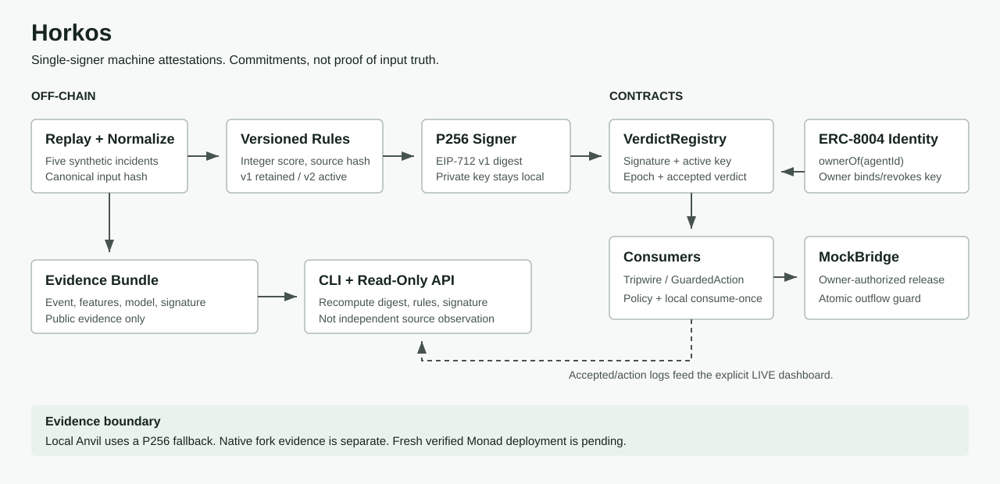

# Implementation Architecture

## Signed Decision Path

1. The replay normalizes an event and hashes its typed ABI encoding.
2. Tripwire's versioned integer rules produce a score. The model hash commits to
   scorer source and configuration; v1 remains verifiable, v2 is the active replay.
3. A P256 signer signs the eight-field EIP-712 v1 verdict. Anyone may relay it.
4. `VerdictRegistry` checks the currently bound active key, signature and expiry,
   stores the verdict's key epoch and emits `VerdictAccepted`.
5. A consumer checks application trust, freshness and per-consumer consume-once.
   Tripwire applies a bounded restriction; MockBridge calls `recordOutflow`
   before transferring native value in the same transaction.

Source: [pipeline](packages/sentinel/src/pipeline.ts),
[registry](contracts/src/VerdictRegistry.sol),
[consumer base](contracts/src/HorkosConsumer.sol),
[guardian](contracts/src/examples/TripwireGuardianV2.sol),
[bridge](contracts/src/examples/MockBridge.sol).

## Evidence and Product Surfaces

The CLI and verified API recompute input/model/digest/signature/score. The API
supports bounded local disk storage; deployed public use must remain read-only.
The dashboard defaults to clearly synthetic RECORDED samples. Explicit LIVE
reads shared-ABI accepted/action events and correlates them by verdict ID; it
never substitutes recorded data after RPC failure.

Source: [CLI](packages/cli/src/verify-bundle.ts),
[API](packages/sentinel/src/server.ts),
[verified store](packages/sentinel/src/bundle-store.ts),
[event reader](apps/dashboard/src/feed.ts).

## Trust Boundaries

Identity ownership authorizes key binding/revocation, not scorer truth. A single
signer can attest to false features. Supplied feature evidence is not yet derived
independently from complete bridge log windows. Stateless verification,
WebAuthn, quorum, challenges and zkML are not implemented.

`GuardedAction` demonstrates caller/model/policy/agent/action binding for a
generic approval score. Tripwire scores represent risk, not permission. The
registry does not store inputHash/nonce separately; consumers needing those
commitments must verify the full preimage against the accepted digest.

The local sandbox uses disposable keys, an ERC-8004 mock and an etched P256
fallback. Native Monad fork tests are separate. The historical deployment
manifest is not proof of source equivalence; fresh verified deployment, actual
live runs and hosted product acceptance remain incomplete.

See [SECURITY.md](SECURITY.md), [the guide](integrations/GUIDE.md),
[the status board](docs/06-project-status.md) and the final evidence report.
